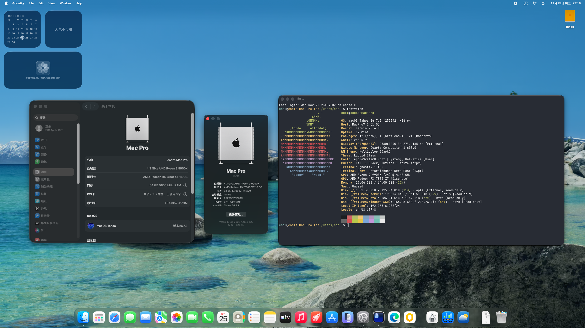

# B650M + Ryzen 9 9900X + Radeon RX 7800 XT Hackintosh (macOS Tahoe 26.7.x)



基于 **OpenCore** 与自改 [**vermilion-navi32**](https://github.com/KawaiiHachimi/vermilion-navi32) 驱动栈构建的 AMD AM5 + RDNA 3（Navi 32 / RX 7800 XT）黑苹果完整配置仓库，运行 **macOS Tahoe 26.7.3 (25G342)**，支持 Metal 3 / OpenGL / OpenCL 硬件加速、2560×1440@165 Hz 动态切率、VCN 硬件解码、屏幕共享、Wi-Fi/蓝牙/AWDL 与板载声卡。

---

## 硬件与系统配置

| 项目 | 配置详情 | 驱动 / 状态 |
|---|---|---|
| **主板** | COLORFIRE B650M（BIOS 1019，AM5 芯片组） | `SSDT-EC-USBX.aml`、`SSDT-CPUR.aml` |
| **处理器** | AMD Ryzen 9 9900X（12C / 24T，Granite Ridge） | `AMD_Vanilla` 内核补丁、`RestrictEvents`、`AppleMCEReporterDisabler` |
| **独立显卡** | AMD Radeon RX 7800 XT 16 GB（Navi 32，`1002:747e` rev `0xC8`） | `VermilionBoot` (`b167`) + `VermilionAccel` + `NVMTLDriver` (Release) + `Mesa RADV` |
| **内存** | 64 GB DDR5-5600（2 × 32 GB） | 正常识别 |
| **显示器** | 27" P27QBA-RX（DisplayPort，2560×1440 @ 165 Hz） | 60 / 120 / 144 / 165 Hz 自由切换，待机板卡功耗 ~33–36 W |
| **有线网卡** | Realtek RTL8125B 2.5GbE | `RTL812xLucy.kext` (`1.1.3`)，正常 |
| **无线网卡 / 蓝牙** | Intel Wi-Fi 6 AX200 (`8086:2723`) | `ForbiddenItlwm` (`0.6.0`) + `BTLEAdvFixup` (`0.9.3`) + `IntelBluetoothFirmware` (`2.5.3`) + `BlueToolFixup` (`2.7.2`)，含 AWDL |
| **板载声卡** | Realtek ALC897（`10EC:0897`） | `SimpleHDA.kext` (`1.0.1`) + `AppleALC.kext` (`1.9.8`)，`alcid=31` |
| **USB 定制** | COLORFIRE B650M 端口映射 | `USBToolBox.kext` (`1.2.0`) + `UTBMap.kext` |
| **存储** | aigo P7000Z 2 TB NVMe / 外置 macOS APFS SSD | 正常（TRIM 支持） |
| **系统版本** | macOS Tahoe 26.7.3 (`25G342`) | SMBIOS：`MacPro7,1` |
| **引导程序** | OpenCore (`ResizeAppleGpuBars = 10`，1 GiB BAR0) | `Target = 0`（已关闭调试日志与 `-v` 跑码） |

### 实测功能与基准

- **Metal 3**：支持全桌面合成与硬件加速，Geekbench 7.1.0 Metal 11/11 全项通过，开启 1 GiB BAR0 + VRAM BO 池 + `NVMTL_SHARED_VRAM=1` 得分 **80,690**（[记录](https://browser.geekbench.com/v7/gpu/438570)）。
- **OpenCL**：11/11 全项通过（含 `RAW` 与 `Feature Matching` 校验），得分 **47,454**（[记录](https://browser.geekbench.com/v7/gpu/438572)）。
- **OpenGL**：通过 Apple `AppleMetalOpenGLRenderer` 运行于 GPU（`phxboot-gl`）。
- **视频硬件解码**：VCN 4.0（HEVC / AV1）硬件解码可用（`PhxVideoDecoder.bundle` + `libphxdec_hevc.dylib`）。
- **HiDPI 缩放支持**：`VermilionAccel.kext` 已内置 `IOFBScalerInfo` 发布与缩放 HiDPI 时序校验，配合自定义显示器 Override（如 [`open-hidpi`](https://github.com/JayHygge/open-hidpi)）即可在 2K 屏上开启 `1920×1080 HiDPI`（`3840×2160` 渲染缓冲 @ 165 Hz）等原生高刷缩放模式。
- **屏幕共享（Screen Sharing）**：已修复原生 2K（`BGRA8` → `RGBA8` 纹理视图格式列表）及任意缩放 / HiDPI 分辨率（`ScreensharingAgent` OpenCL 缩放核写入带 swizzle 纹理视图落入 dummy 纹理）导致的黑屏问题。
- **电源与风扇管理**：待机自动关闭 SDMA、开启 GFX Clock Gating 与空闲 DPM（非 165 Hz 极短 VBLANK 模式下自动回落低频，防止 PMFW 卡死）。
- **已知限制**：AMD 平台原生无 Apple Hypervisor 支持（如需基于 HVF / Virtualization.framework 运行虚拟机，可关注社区 AMD SVM 虚拟化扩展，如 [RyzenHV](https://github.com/OverlordDev/ryzen-hypervisor.framework) 与 [AMDVirt](https://github.com/liamhnam/AMDVirt)）、暂未启用系统 S3 睡眠、DRM 受保护视频（如 Apple TV 影片）受限于 Apple 硬件解密路径。

---

## 目录结构

```text
.
├── assets/
│   └── desktop.png                 # 当前系统桌面与配置截图
├── EFI/                            # 精简纯净的 OpenCore EFI（仅含 BOOT 与 OC）
│   ├── BOOT/
│   └── OC/
│       ├── ACPI/                   # SSDT-CPUR.aml, SSDT-EC-USBX.aml
│       ├── Drivers/                # OpenRuntime, OpenCanopy, OpenHfsPlus, Ext4Dxe 等
│       ├── Kexts/                  # 仅包含已启用的 14 个驱动（已移除历史残留）
│       ├── Resources/              # OpenCanopy 主题资源
│       └── config.plist            # 已关闭 OpenCore 调试日志与 -v 跑码
└── PostInstall/                    # 系统内注入的扩展、Metal/Vulkan 驱动与启动脚本
    ├── Extensions/
    │   └── VermilionAccel.kext     # 安装到 /Library/Extensions/ 并重建 AuxKC
    ├── GPUBundles/
    │   ├── NVMTLDriver.bundle/     # Metal-on-Vulkan 驱动（NVMTL_RELEASE=1 无持续日志）与 AIR->SPIR-V 翻译器
    │   ├── nvmtl/                  # Mesa RADV Vulkan 驱动 (libvulkan_radeon.dylib)
    │   └── nvmtl-allow.txt         # Metal 进程白名单
    ├── VideoPlugIns/
    │   └── PhxVideoDecoder.bundle/ # 可选：VCN 硬件解码 VideoToolbox 插件
    ├── LaunchDaemons/
    │   └── local.phxboot.plist.in  # 开机 GPU bring-up 守护进程模板（需替换用户名）
    └── gpu-scripts/                # 放入 ~/gpu/ 的初始化、切率、功耗控制与默认开关文件
```

> **说明**：为遵守许可协议并避免泄露隐私，本仓库**不包含**任何账号凭据（如 `kcpassword.bin`）、日志文件、Apple 专有 `air-runtime` 运行库以及 AMD 专有 GPU 固件（`*.bin`），下文安装步骤说明如何自行补齐。

---

## 简要安装方式（全新复刻）

### 1. BIOS 推荐设置

- **Above 4G Decoding**：`Enabled`
- **Resizable BAR Support**：`Enabled`（配合 OpenCore `ResizeAppleGpuBars = 10` 暴露 1 GiB BAR0）
- **CSM (Compatibility Support Module)**：`Disabled`
- **Fast Boot / Secure Boot**：`Disabled`
- **主显示输出**：独立显卡（PCIe Slot 1）

### 2. 部署 EFI 并安装 macOS Tahoe 26.7.x

1. 将本仓库中的 [`EFI/`](EFI/) 整体复制到目标磁盘的 EFI 分区根目录。
2. 建议按需检查/重新生成 `PlatformInfo -> Generic` 三码（如需要正常使用 iCloud / iMessage），并按自己主机板 USB 实际情况微调 `UTBMap.kext`。
3. 首次安装 macOS 时可先不触发 GPU 桌面接管，以基础帧缓冲完成系统安装并关闭 SIP（`csr-active-config` 已在 `config.plist` 中配置）。

### 3. 安装系统级扩展与 GPU 驱动栈

```bash
# 1) 安装 VermilionAccel.kext 到 /Library/Extensions 并重建 AuxKC
sudo cp -R PostInstall/Extensions/VermilionAccel.kext /Library/Extensions/
sudo chown -R root:wheel /Library/Extensions/VermilionAccel.kext
sudo kmutil load -p /Library/Extensions/VermilionAccel.kext
# 在“系统设置 -> 隐私与安全性”点击允许扩展并重启以重建 Auxiliary Kernel Collection

# 2) 安装 NVMTLDriver.bundle、Mesa RADV 与进程白名单
sudo mkdir -p /Library/GPUBundles/nvmtl/aircache /Library/GPUBundles/nvmtl/spvcache
sudo cp -R PostInstall/GPUBundles/NVMTLDriver.bundle /Library/GPUBundles/
sudo cp -p PostInstall/GPUBundles/nvmtl/libvulkan_radeon.dylib /Library/GPUBundles/nvmtl/
sudo cp -p PostInstall/GPUBundles/nvmtl-allow.txt /Library/GPUBundles/
sudo chown -R root:wheel /Library/GPUBundles/NVMTLDriver.bundle /Library/GPUBundles/nvmtl/libvulkan_radeon.dylib /Library/GPUBundles/nvmtl-allow.txt
sudo chown _windowserver:wheel /Library/GPUBundles/nvmtl/aircache /Library/GPUBundles/nvmtl/spvcache
sudo chmod 0755 /Library/GPUBundles/nvmtl/aircache /Library/GPUBundles/nvmtl/spvcache
sudo chmod 0644 /Library/GPUBundles/nvmtl-allow.txt
```

### 4. 补齐 AIR 运行库与 Navi 32 固件

1. **AIR 运行库（`air-runtime`）**：通过 MacPorts 安装 `llvm-21` 与 `spirv-tools`，执行 `PostInstall/gpu-scripts/phxctl/air_runtime_install.sh` 将自包含、ad-hoc 签名的 LLVM 动态库安装到 `/Library/GPUBundles/NVMTLDriver.bundle/Contents/MacOS/air-runtime/`，并链接 `spirv-val` 到 `/usr/local/bin/spirv-val`（详细步骤见 [vermilion-navi32 安装手册](https://github.com/KawaiiHachimi/vermilion-navi32/blob/navi32-port/docs/NAVI32-INSTALL.md)）。
2. **Navi 32 固件**：从 Linux `linux-firmware` 的 `amdgpu/` 目录复制以下 13 个固件到 `~/gpu/fw/navi32/`：
   - `dcn_3_2_0_dmcub.bin`
   - `gc_11_0_3_imu.bin`、`gc_11_0_3_me.bin`、`gc_11_0_3_mec.bin`、`gc_11_0_3_mes1.bin`、`gc_11_0_3_mes_2.bin`、`gc_11_0_3_pfp.bin`、`gc_11_0_3_rlc.bin`
   - `psp_13_0_10_sos.bin`、`psp_13_0_10_ta.bin`
   - `sdma_6_0_3.bin`、`smu_13_0_10.bin`、`vcn_4_0_0.bin`

### 5. 部署开机启动脚本与 LaunchDaemon

```bash
# 1) 复制脚本、工具与推荐开关文件到 ~/gpu
mkdir -p ~/gpu
cp -R PostInstall/gpu-scripts/* ~/gpu/
sudo cp ~/gpu/mesboot /usr/local/sbin/mesboot
sudo cp ~/gpu/phxctl.bin /usr/local/sbin/phxctl
sudo chmod 755 /usr/local/sbin/mesboot /usr/local/sbin/phxctl

# 2) 安装 LaunchDaemon（将 <YOUR_USER> 替换为你的 macOS 用户名）
sed "s|@PHX_ROOT@|/Users/$USER/gpu|g; s|@PHX_USER@|$USER|g" \
  PostInstall/LaunchDaemons/local.phxboot.plist.in \
  | sudo tee /Library/LaunchDaemons/local.phxboot.plist >/dev/null
sudo chown root:wheel /Library/LaunchDaemons/local.phxboot.plist
sudo chmod 644 /Library/LaunchDaemons/local.phxboot.plist
sudo plutil -lint /Library/LaunchDaemons/local.phxboot.plist

# 3) 首次启用完整硬件加速桌面（需完全冷启动或设置 squat 后重启）
sudo nvram phxfb-squat=1
sudo reboot
```

> **默认已开启的优化标志（位于 `~/gpu/`）**：
> - `phxboot-auto`：成功后自动续签下次开机的加速桌面
> - `phxboot-p0modes`：启用多刷新率模式切换（60 / 120 / 144 / 165 Hz）
> - `phxboot-gl`：启用 GPU OpenGL-over-Metal 加速
> - `phxboot-vcn`：开机拉起 VCN 硬件解码引擎
> - `phxboot-irqwait`：启用硬件中断式 fence 等待（降低 GPU 等待延迟）
> - `phxboot-bovram`：启用本地 GDDR6 显存 BO 池（可在文件内按逗号追加需要高速显存的游戏/应用进程名，注意不要加入 `WindowServer`）
> - *(可选)* VCN 视频解码插件 `PostInstall/VideoPlugIns/PhxVideoDecoder.bundle` 需安装到 `/System/Library/Video/Plug-Ins/`（会解除系统卷封印，如不需要系统级 VideoToolbox 硬解可跳过）。
> - *(可选)* **2K 显示器 HiDPI 缩放**：`VermilionAccel.kext` 已支持通用缩放 HiDPI 模式，本仓库不包含针对特定显示器的 Override 文件；如需在 2560×1440 等非 4K 屏幕上启用 `1920×1080 HiDPI` 等缩放档位，可使用 [JayHygge/open-hidpi](https://github.com/JayHygge/open-hidpi) 为自己的显示器生成 `/Library/Displays/Contents/Resources/Overrides/DisplayVendorID-*/DisplayProductID-*` 并重启生效。
> - *(可选)* **AMD 平台虚拟化（未内置）**：本仓库默认未集成虚拟化扩展；如需在 AMD 黑苹果上使用依赖原生虚拟化框架的虚拟机或容器，可参考以下开源 AMD SVM Kext 项目：
>   - **[RyzenHV](https://github.com/OverlordDev/ryzen-hypervisor.framework)**：通过 Kext 实现 AMD SVM 并接入 `Hypervisor.framework`，在 Parallels、Docker、QEMU 上已有成功案例（含 macOS Tahoe 实测）。
>   - **[AMDVirt](https://github.com/liamhnam/AMDVirt)**：通过 Kext 实现 AMD SVM 并兼容 Apple 原生虚拟化 API，已宣称跑通 `Virtualization.framework`、UTM 与 Lima。

---

## Credits & 致谢

本项目的实现离不开以下优秀的开源项目与上游贡献者：

### GPU 加速与本机移植项目

- **本项目使用的 Navi 32 移植分支**：[KawaiiHachimi/vermilion-navi32](https://github.com/KawaiiHachimi/vermilion-navi32)（`navi32-port` 分支，在 RX 7800 XT 上完成了 Navi 32 适配、165 Hz 切率与短 VBLANK 保护、通用 HiDPI 缩放支持、Geekbench 7 Metal/OpenCL 翻译修复与屏幕共享全分辨率修复）
- **上游 Vermilion XTX**：[ownback/vermilion-xtx](https://github.com/ownback/vermilion-xtx)（1440p 高刷回放、VRAM BO 池、中断等待、空闲功耗管理、VCN 解码与桌面稳定性改进）
- **原始上游 Vermilion**：[leolivm/vermilion](https://github.com/leolivm/vermilion)（RDNA 3 macOS 引导、帧缓冲与 Metal-over-RADV 原始架构）
- **NullMoth**：[nullmoth/nvidia-macos-driver](https://github.com/nullmoth/nvidia-macos-driver)（`NVMTLDriver` Metal-on-Vulkan 插件、`libnvmtl_translate` AIR→SPIR-V 翻译器及 `NVAccel` 的原始来源）
- **Mesa RADV**：[Mesa 3D Graphics Library](https://gitlab.freedesktop.org/mesa/mesa)（AMD RDNA 3 开源 Vulkan 驱动与 ACO 着色器编译器）
- **RedNavi**：Navi 32 早期显示引擎与硬件初始化参考

### OpenCore 与黑苹果基础驱动

- **OpenCore / Acidanthera**：[OpenCorePkg](https://github.com/acidanthera/OpenCorePkg)、[Lilu](https://github.com/acidanthera/Lilu)、[VirtualSMC](https://github.com/acidanthera/VirtualSMC)、[AppleALC](https://github.com/acidanthera/AppleALC)、[RestrictEvents](https://github.com/acidanthera/RestrictEvents)、[BrcmPatchRAM (`BlueToolFixup`)](https://github.com/acidanthera/BrcmPatchRAM)
- **AMD 内核补丁**：[AMD-OSX/AMD_Vanilla](https://github.com/AMD-OSX/AMD_Vanilla)
- **Intel Wi-Fi & AWDL**：[retropineaple/ForbiddenItlwm](https://github.com/retropineaple/ForbiddenItlwm)（`ForbiddenItlwm`、`BTLEAdvFixup`）
- **Intel 蓝牙固件**：[OpenIntelWireless/IntelBluetoothFirmware](https://github.com/OpenIntelWireless/IntelBluetoothFirmware)
- **Realtek 2.5G 网卡**：[Mieze/RTL812xLucy](https://github.com/Mieze/RTL812xLucy)
- **ALC897 声卡辅助**：[laobamac/SimpleHDA](https://github.com/laobamac/SimpleHDA)
- **USB 定制**：[USBToolBox/kext](https://github.com/USBToolBox/kext)
- **HiDPI 显示器 Override 工具**：[JayHygge/open-hidpi](https://github.com/JayHygge/open-hidpi)
- **AMD MCE 禁用**：`AppleMCEReporterDisabler`
